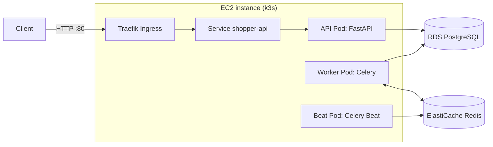

# Shopper Helper

A backend service for shoppers who are standing in a store and need a fast answer. You enter the product you're looking at and its price, and the API returns similarly priced products in the same category, ranked by critic review scores and compared against the product in your hand.

Built as a portfolio project to practice the full path from API code to a deployed, containerized system: FastAPI, PostgreSQL, Redis, Celery, Docker, Kubernetes (k3s), AWS, and CI.

## Status

**Works today**
- Fuzzy product matching that tolerates typos (PostgreSQL `pg_trgm`)
- Price-range search with rating comparison against the baseline product, with pagination
- Scheduled and on-demand price refresh through Celery
- Runs locally with Docker Compose, and on a k3s cluster on AWS EC2 with managed PostgreSQL (RDS) and Redis (ElastiCache)
- CI pipeline that builds, smoke-tests and pushes images to ECR on every push to `main`

**Not done yet**
- Prices are placeholders. The refresh task adds random jitter to the last price. A real price source is still to be wired in.
- Reviews are seeded sample data, not scraped.
- Redis is only the Celery broker. Search results are not cached yet.
- Deploys to the cluster are manual (the pipeline builds and pushes images, but does not deploy them).
- The ECR pull secret in the cluster expires every 12 hours and is refreshed by hand.
- No automated tests yet beyond the import smoke test in CI.
- Schema changes use `create_all`, so there are no migrations (Alembic is planned).
- Aspect-level review scores (bass, battery, and so on) are in the schema but not used in ranking.
- The cluster is stopped between working sessions, so there is no permanent public URL.

## Architecture



| Component | Role |
|---|---|
| API (FastAPI, async) | Serves `/products/match` and `/search`, plus liveness and readiness probes |
| Worker (Celery) | Executes `refresh_price` tasks and writes new price snapshots |
| Beat (Celery) | Triggers `refresh_all_prices` daily at 03:00 UTC, which fans out one `refresh_price` task per product |
| PostgreSQL 16 | Source of truth, with the `pg_trgm` extension for fuzzy matching |
| Redis 7 | Celery broker and result backend |

**Data model**
- `products`: name, category, JSON specs
- `price_snapshots`: append-only history, so every refresh adds a row and the API reads the latest per product
- `reviews`: one row per product and critic source, with rating and link
- `review_aspects`: optional per-aspect scores for a review

## API

| Endpoint | Purpose |
|---|---|
| `GET /products/match?q=<text>&category=<optional>&limit=10` | Typo-tolerant search. Returns candidates to pick from. |
| `GET /search?product_id=<id>&price_range=5&limit=20&offset=0` | Products within ±`price_range` of the baseline's latest price, ranked by average critic rating, with `rating_diff` against the baseline |
| `GET /health/live` | Process is up (no dependency checks) |
| `GET /health/ready` | Database is reachable (returns 503 if not) |

Interactive docs are served at `/docs`.

```bash
curl 'http://localhost:8000/products/match?q=oppo'
curl 'http://localhost:8000/search?product_id=1&price_range=5'
```

Ranking uses critic and tech-site reviews only, so a single extreme rating cannot dominate the way it can with user reviews. Source count is shown and used as a tiebreak.

## Run locally

Requires Docker with the Compose plugin.

```bash
docker compose up -d --build
docker compose exec api python -m scripts.init_db
docker compose exec api python -m scripts.seed_test_data
```

`init_db` is safe to repeat. `seed_test_data` is not, so run it once or you get duplicate products.

Then open http://localhost:8000/docs. To trigger a price refresh by hand:

```bash
docker compose exec worker python -c "from worker.tasks import refresh_all_prices; print(refresh_all_prices.delay().id)"
docker compose logs worker --tail 15
```

The passwords in `docker-compose.yml` are development values only.

## Deployment

The manifests in `k8s/` define a ConfigMap, a Secret, Deployments for api, worker and beat, a Service, and a Traefik Ingress. PostgreSQL and Redis are not run in the cluster. They are RDS and ElastiCache, reachable only from the instance through security group rules that reference the instance's security group, not IP addresses.

`k8s/secret.yaml` contains a placeholder password. The real one is set on the cluster only and is never committed.

## CI

`.github/workflows/build-push.yml` runs on every push to `main`:

1. Assume an AWS role through GitHub OIDC. No long-lived AWS keys are stored in GitHub. The role's trust policy is restricted to this repository and the `main` branch.
2. Build the `api` and `worker` images.
3. Smoke test: start each image and import its application module.
4. Push both images to ECR, tagged with the first 7 characters of the commit hash.

## Design decisions

- **Prices are append-only snapshots,** so a price history and a "price as of 2 hours ago" display are possible. Reviews are updated in place because only the current rating matters.
- **Separate liveness and readiness probes.** Liveness never checks dependencies, so a database outage doesn't cause pointless container restarts. Readiness does check the database, so traffic isn't routed to an instance that can't serve it.
- **Fan-out refresh.** The scheduled task only enqueues one small task per product, so products refresh in parallel across workers and fail independently.
- **Beat runs as its own single-replica Deployment with a `Recreate` strategy,** so two schedulers never fire the same job.
- **Images are multi-stage and run as a non-root user.**
- **Batched queries.** The search endpoint fetches ratings and reviews for all candidates in two queries instead of two per product.
- **Access to the instance goes through AWS Systems Manager,** with no SSH port open.

## Project layout

```
api/        FastAPI app and Dockerfile
worker/     Celery app, tasks, Dockerfile (also used for beat)
shared/     Settings, SQLAlchemy models, DB engines, Pydantic schemas
scripts/    One-off database and debugging scripts
k8s/        Kubernetes manifests
.github/    CI workflow
```

## Stack

Python 3.10, FastAPI, SQLAlchemy 2.0 (async, psycopg 3), PostgreSQL 16 with `pg_trgm`, Redis 7, Celery, Docker, Docker Compose, k3s, Traefik, AWS (EC2, RDS, ElastiCache, ECR, IAM, Systems Manager), GitHub Actions.
